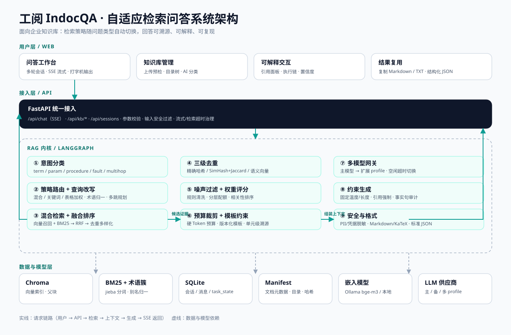

# 工阅 IndocQA

> 通用 RAG 引擎 + 声明式领域插件。检索、切块、上下文组装、引用审计与流式输出属于引擎能力；行业术语、分类规则、意图关键词、目录模板与回答风格由 **Domain Pack** 提供。

IndocQA 面向企业知识库场景，提供两条并行的能力链路：面向终端问答的**问答与知识运营链路**，以及面向知识治理与可复现构建的**控制面与构建编排链路**。两条链路共享同一进程与模型配置，但拥有独立的路由族、数据目录与生命周期语义。

---

## 目录

- [1. 项目定位](#1-项目定位)
- [2. 核心特性](#2-核心特性)
- [3. 架构总览](#3-架构总览)
- [4. 快速开始](#4-快速开始)
- [5. Domain Pack](#5-domain-pack)
- [6. API 摘要](#6-api-摘要)
- [7. 评测](#7-评测)
- [8. 测试与 CI](#8-测试与-ci)
- [9. 部署与运维](#9-部署与运维)
- [10. 目录结构](#10-目录结构)
- [11. 已知边界](#11-已知边界)
- [12. 文档导航](#12-文档导航)
- [13. 贡献指南](#13-贡献指南)
- [14. 许可证](#14-许可证)

---

## 1. 项目定位

| 维度   | 说明                                                                                                      |
| ------ | --------------------------------------------------------------------------------------------------------- |
| 引擎   | 解析、切块、嵌入编排、混合检索、上下文组装、生成、引用审计、评测                                          |
| 插件   | 纯声明式 Domain Pack：术语、解析规则、目录模板、分类、意图、数据事实、权威度、角色、提示词、UI 文案、评测 |
| 边界   | 引擎目录不含行业词汇；领域差异全部由 Pack 与配置声明                                                      |
| 不提供 | 多租户、RBAC、SSO、代码级插件、Pack 市场、外部向量库与 Postgres 控制面                                    |

具体领域不再硬编码在引擎中。仓库内置 `example-minimal` 与 `customer-service-faq` 两个可运行 Pack，用于演示最小接入与完整领域接入。

---

## 2. 核心特性

### 引擎与领域解耦

- Domain Pack 声明 `terms / parser / folders / classification / intent / data-facts / authority / persona / prompts / ui / eval`。
- 引擎与前端不出现行业词汇，由 `tests/test_domain_leakage.py` 静态守卫。
- Pack 支持安装、绑定、快照、字段级 diff、内容哈希与卸载保护。

### Build 生命周期

- 每个 Build 拥有独立的向量与关键词命名空间；同一 KB 的 `id+version` 内容不可变。
- 状态机 `draft → ready → active → archived`，支持 active/previous 指针与回滚。
- Build 快照记录 Pack、流水线版本与嵌入指纹；相同 Pack + 相同语料 + 相同模型可重建等价结果。
- 增量文档写入 active Build，`corpus_revision` 自增；文档替换进入撤销缓存，可回滚到上一版本。
- 部分文档失败时 Build 为 `ready + warning`；零分块或全量失败时为 `blocked`，不允许激活。

### 检索与生成

- 向量 + BM25 混合检索，RRF 融合；三档预设 `precision@1 / balanced@1 / recall@1`。
- 问答链路支持意图分类（术语/参数/流程/故障/多跳）、术语扩展、上下文预算、去重与噪声过滤。
- 引用审计、数据事实校验、安全过滤、结构化 JSON 输出。
- SSE 六事件：`trace / context / sources / token / done / error`。

### 文档与多模态

- PDF / Markdown / TXT 解析，父子切块，表格独立成块。
- 多级目录、移动/重命名/删除、AI 目录分类与反馈。
- 会话与附件：分片上传、断点续传、文档/图片/音频/视频附件（部分格式以元数据或转写参与上下文）。

### 可运维

- `/api/v1` 静态 Bearer 鉴权（`INDOCQA_AUTH_TOKEN`，健康检查与 loopback 例外）。
- 健康检查、审计日志、索引对账（孤儿清理/缺失补队）、Outbox 最终一致。
- CLI：`init / validate / build / query`。
- 单 worker 约束、备份恢复与 Build/数据/代码三层回滚流程。

---

## 3. 架构总览



### 两条并行链路

| 维度     | 问答与知识运营链路（`/api`）              | 控制面与构建编排链路（`/api/v1`）                |
| -------- | ------------------------------------------- | -------------------------------------------------- |
| 目标     | 终端问答、文档运营、会话与附件              | 知识库治理、可复现构建与回滚                       |
| 输出契约 | SSE 事件流；`{data}` / `{error}` 包装   | 版本化 JSON；统一错误包；`X-API-Version: 1`      |
| 事实源   | 当前索引与 `manifest`                     | 控制面 SQLite（KB / Build / 文档 / 审计 / Outbox） |
| 生命周期 | 当前状态可修改                              | 不可变 Build + active/previous 指针                |
| 检索能力 | 意图路由、多跳、术语扩展、自适应参数        | Build 级基础混合检索，强调可复现                   |
| 鉴权     | 依赖反向代理层                              | 可选静态 Bearer Token                              |
| 数据目录 | `server/data/chroma`、`db`、`uploads` | `server/data/engine`                             |

两链路通过 `kbId` 桥接：`POST /api/chat` 携带 `kbId` 且该 KB 有 active Build 时，问答请求可使用构建链路的 Build 级检索；失败自动回退问答链路。

### 分层职责

| 层     | 目录                      | 职责                                       |
| ------ | ------------------------- | ------------------------------------------ |
| 契约层 | `server/app/contracts/` | 接口、值对象、配置 Schema，不依赖具体实现  |
| 引擎层 | `server/app/engine/`    | Build、索引、入库、检索编排、模型注册      |
| 插件层 | `server/packs/`         | 声明式 Domain Pack                         |
| 适配层 | `server/app/adapters/`  | Chroma、BM25、本地对象存储、嵌入模型       |
| 控制面 | `server/app/control/`   | SQLite 事实源、Outbox、对账                |
| 接口层 | `server/app/api/`       | `/api` 与 `/api/v1` 路由、鉴权、错误包 |
| 前端   | `web/src/`              | 问答、文档管理、引擎配置                   |

更多设计说明见 [docs/ARCHITECTURE.md](docs/ARCHITECTURE.md)。

---

## 4. 快速开始

### 4.1 环境要求

| 依赖           | 版本                                           |
| -------------- | ---------------------------------------------- |
| Python         | 3.11+（推荐 3.13）                             |
| Node.js        | 20+                                            |
| uv             | 最新版                                         |
| Ollama（可选） | 用于 `bge-m3` 嵌入；不可用时自动回退本地模型 |

### 4.2 安装

```bash
# 后端
cd server
cp .env.example .env        # Windows: copy .env.example .env
uv sync --extra dev

# 前端
cd ../web
npm ci
```

### 4.3 启动

```bash
# 终端 1：后端
cd server
uv run uvicorn app.main:app --host 127.0.0.1 --port 8010

# 终端 2：前端
cd web
npm run dev
```

打开 `http://127.0.0.1:5174`。

> 也可使用 `scripts/start.ps1`（Windows）或 `scripts/start.sh`（Linux/macOS）一键启动。

### 4.4 导入示例语料

```bash
cd server
uv run python -m app.indexing.ingest ../data/corpus
```

如需启用客服 FAQ Pack 的术语/分类/意图/风格覆盖，在 `server/.env` 中设置：

```bash
INDOCQA_LEGACY_PACK=customer-service-faq@1.0.0
```

### 4.5 创建知识库与 Build

```bash
# 安装 Pack
curl -X POST http://127.0.0.1:8010/api/v1/packs/install \
  -H 'Content-Type: application/json' \
  -d '{"packId":"customer-service-faq","version":"1.0.0"}'

# 创建 KB
curl -X POST http://127.0.0.1:8010/api/v1/kbs \
  -H 'Content-Type: application/json' \
  -d '{"kbId":"kb_cs","name":"客服库","domainPackId":"customer-service-faq","domainPackVersion":"1.0.0"}'

# 创建 Build：自动入库并激活
curl -X POST http://127.0.0.1:8010/api/v1/kbs/kb_cs/builds \
  -H 'Content-Type: application/json' \
  -d '{"preset":"balanced@1","corpusDir":"corpus","activate":true}'
```

`corpusDir` 必须位于数据根目录内（相对数据根目录或绝对路径）。

### 4.6 提问

```bash
# 问答链路
curl -N -X POST http://127.0.0.1:8010/api/chat \
  -H 'Content-Type: application/json' \
  -d '{"message":"退款一般多久到账？","mode":"kb"}'

# 带 kbId：优先使用 active Build 的 Build 级检索
curl -N -X POST http://127.0.0.1:8010/api/chat \
  -H 'Content-Type: application/json' \
  -d '{"message":"退款一般多久到账？","mode":"kb","kbId":"kb_cs"}'
```

若设置了 `INDOCQA_AUTH_TOKEN`，`/api/v1` 请求需带 `Authorization: Bearer <token>`。

### 4.7 CLI

```bash
cd server

# 初始化项目配置（--corpus 相对项目目录）
uv run python -m app.cli init \
  --dir .tmp-demo \
  --name "示例知识库" \
  --pack customer-service-faq@1.0.0 \
  --corpus ../data/corpus

# 校验配置与 Pack
uv run python -m app.cli validate --dir .tmp-demo

# 构建（默认激活；加 --no-activate 可只构建）
uv run python -m app.cli build --dir .tmp-demo

# 检索
uv run python -m app.cli query --dir .tmp-demo "退款一般多久到账？"
```

---

## 5. Domain Pack

| Pack                           | 领域         | 资产                                      | 用途                     |
| ------------------------------ | ------------ | ----------------------------------------- | ------------------------ |
| `example-minimal@1.0.0`      | 通用最小样例 | 术语、目录、意图、UI 文案                 | 快速验证 Pack 结构与加载 |
| `customer-service-faq@1.0.0` | 客服 FAQ     | 15 术语簇、5 类问法、4 篇合成语料、评测集 | 完整领域接入与端到端验证 |

Pack 目录结构：

```text
server/packs/<pack-id>/<version>/
  manifest.json         # id / version / domain / engine_range
  terms.json            # 术语同义簇
  parser.json           # 文件名规则、目录推断、跳过规则
  folders.json          # 目录模板
  classification.json   # 分类规则
  intent.json           # 意图关键词与连接词
  data-facts.json       # 数据事实校验
  authority.json        # 来源权威度
  persona.json          # 角色与语气
  prompts.json          # 提示词风格
  ui.json               # 界面文案
  eval.json             # 评测集引用
```

编写、安装、升级与术语缓存规则见 [docs/PACK_GUIDE.md](docs/PACK_GUIDE.md)。

---

## 6. API 摘要

### 问答与知识运营链路 `/api`

| 方法                  | 路径                   | 说明                                    |
| --------------------- | ---------------------- | --------------------------------------- |
| POST                  | `/api/chat`          | SSE 问答；可选 `kbId` 桥接 Build 检索 |
| POST                  | `/api/kb/ingest`     | 上传入库（同步/异步任务）               |
| GET                   | `/api/kb/documents`  | 文档列表（可按目录）                    |
| GET/POST/PATCH/DELETE | `/api/kb/folders`    | 多级目录管理                            |
| POST                  | `/api/kb/classify`   | AI 目录分类                             |
| GET/POST/PATCH/DELETE | `/api/sessions/*`    | 会话管理                                |
| POST                  | `/api/attachments/*` | 分片上传与附件生命周期                  |

### 控制面与构建编排链路 `/api/v1`

| 方法            | 路径                                        | 说明                                                             |
| --------------- | ------------------------------------------- | ---------------------------------------------------------------- |
| GET             | `/api/v1/health`                          | 引擎健康与版本                                                   |
| GET/POST        | `/api/v1/kbs`                             | 知识库列表/创建                                                  |
| POST            | `/api/v1/packs/install`                   | 安装 Domain Pack                                                 |
| POST/GET/DELETE | `/api/v1/kbs/{kb}/pack`                   | 绑定/查询/解绑 Pack                                              |
| POST            | `/api/v1/kbs/{kb}/builds`                 | 创建 Build；可选 `embeddingModel`、`corpusDir`、`activate` |
| POST            | `/api/v1/builds/{id}/activate`            | 激活 Build                                                       |
| POST            | `/api/v1/kbs/{kb}/rollback`               | 回滚到历史 Build                                                 |
| POST            | `/api/v1/kbs/{kb}/documents/ingest`       | 向 active Build 增量上传文档                                     |
| POST            | `/api/v1/kbs/{kb}/documents/{id}/replace` | 替换文档并写入撤销缓存                                           |
| POST            | `/api/v1/kbs/{kb}/documents/{id}/undo`    | 撤销最近一次替换                                                 |
| POST            | `/api/v1/search`                          | 按 KB 或 Build 检索                                              |
| GET             | `/api/v1/ui-profile`                      | 当前或指定 `kbId` 的 UI Profile                                |

错误包统一为 `{error: {code, name, message, detail, retryable, requestId}}`。完整契约与 SSE 事件见 [docs/API.md](docs/API.md)。

---

## 7. 评测

```bash
# 检索质量（客服 FAQ 标注集，16 题）
uv run --project server python eval/harness.py

# 全链路基准（检索质量、时延、入库吞吐、并发）
uv run --project server --with matplotlib --with psutil python eval/perf_benchmark.py
```

当前客服 FAQ 基线（2026-11-18，本地环境）：

| 模式     | Hit@1 | Hit@3 | Hit@5 | Recall@5 | MRR   | 要点覆盖 |
| -------- | ----- | ----- | ----- | -------- | ----- | -------- |
| fixed    | 0.875 | 1.000 | 1.000 | 1.000    | 0.938 | 0.938    |
| adaptive | 0.875 | 1.000 | 1.000 | 1.000    | 0.938 | 0.969    |

基准报告与图表由脚本在 `docs/performance/` 本地生成，不随仓库提交。

---

## 8. 测试与 CI

```bash
# 后端
cd server
uv run pytest -q
uv run ruff check app tests

# 前端
cd web
npm run lint
npm run build
```

CI（`.github/workflows/ci.yml`）覆盖：契约快照、领域词守卫、全量后端测试、CLI 冒烟、前端 lint/build。

---

## 9. 部署与运维

- **单 worker**：不要使用 `uvicorn --workers`；控制面 SQLite、Chroma、BM25 侧车与对象存储均为进程内资源。
- **数据目录**：`server/data/engine`（控制面/索引/对象）、`server/data/chroma`（问答链路向量）、`server/data/uploads`、`server/data/db/sessions.db`。
- **备份**：停写后复制 `data/engine`、`data/chroma`、`data/uploads`、`data/db`；恢复后执行 `/api/v1/builds/{id}/reconcile` 对账。
- **回滚**：Build 级通过 `/api/v1/kbs/{kb}/rollback`；数据与代码按发布清单回退。
- **鉴权**：生产设置 `INDOCQA_AUTH_TOKEN`；健康检查与 loopback 例外。

详见 [docs/DEPLOYMENT.md](docs/DEPLOYMENT.md) 与 [docs/MIGRATION.md](docs/MIGRATION.md)。

---

## 10. 目录结构

```text
server/
  app/
    api/              问答与知识运营（/api）与控制面（/api/v1）路由
    contracts/        引擎契约（配置/索引/嵌入/对象存储/Pack/检索）
    control/          控制面 SQLite、Outbox、对账
    adapters/         Chroma、BM25、本地对象存储、Ollama 嵌入
    engine/           EnginePipeline、运行时、入库、模型注册表
    packs/            Pack 加载/注册/diff/运行时适配
    retrieval/        意图、混合检索、术语、重排
    context/          上下文组装、预算、模板、画像
    generation/       回答、引用、安全、格式化
    indexing/         解析入库、目录、manifest、任务
    parsing/          PDF/Markdown/TXT 解析与切块
    classification/   AI 目录分类
    session/          会话存储
    attachments/      分片上传与附件解析
    cli.py            init / validate / build / query
  config/schemas/     5 份 JSON Schema（engine / kb / answer / ui / pack）
  packs/              example-minimal、customer-service-faq
  tests/              后端测试（269 个用例）

web/src/              问答 / 文档管理 / 引擎配置
eval/                 客服 FAQ 标注集、评测与基准脚本
data/corpus/          客服 FAQ 样例语料 + 中立测试夹具
docs/                 ARCHITECTURE / API / USAGE / DEPLOYMENT / MIGRATION / PACK_GUIDE
scripts/              一键启动与仓库清洁检查
tools/                内核同步工具
```

---

## 11. 已知边界

- **单 worker**：多进程会破坏控制面与索引一致性。
- **真流式待优化**：当前生成链路先缓冲/切片再下发，首 Token 受上游模型影响较大。
- **多跳覆盖有限**：复杂跨文档推理仍是短板。
- **engine 后端为基础检索**：不含问答链路的自适应、多跳与术语扩展；默认 `auto` 仅在带 `kbId` 且 KB 有 active Build 时启用。
- **嵌入模型切换**：Build 级 `embeddingModel` 仅支持同维度模型，模型需已安装；跨维度需新索引与迁移。
- **问答链路单索引**：同一进程的自适应索引仍是单 KB；多 KB 并行问答通过构建链路的 Build 承载。
- **治理能力有限**：当前为静态 Bearer Token，无 RBAC/多租户 UI；`tenant_id` 字段已预留。

---

## 12. 文档导航

| 文档                                   | 内容                                                               |
| -------------------------------------- | ------------------------------------------------------------------ |
| [ARCHITECTURE.md](docs/ARCHITECTURE.md) | 分层架构、双链路、数据流、模块职责与扩展点                         |
| [USAGE.md](docs/USAGE.md)               | 界面使用：问答、文档管理、引擎配置                                 |
| [API.md](docs/API.md)                   | 问答与知识运营（`/api`）和控制面（`/api/v1`）契约、错误码、SSE |
| [DEPLOYMENT.md](docs/DEPLOYMENT.md)     | 安装、配置、单 worker、构建编排部署                                |
| [MIGRATION.md](docs/MIGRATION.md)       | 存量数据迁移、Pack 绑定、Build 切换                                |
| [PACK_GUIDE.md](docs/PACK_GUIDE.md)     | Domain Pack 资产、安装、升级与术语缓存                             |
| [CONTRIBUTING.md](CONTRIBUTING.md)      | 开发环境、代码规范、测试与提交约定                                 |

---

## 13. 贡献指南

1. Fork 仓库并创建功能分支：`feat/<scope>`、`fix/<scope>`、`docs/<scope>`。
2. 遵守分层边界：领域内容只进 `server/packs/`，不进入 `server/app` 或 `web/src`。
3. 提交前运行后端 `pytest`、`ruff` 与前端 `lint`、`build`；新增行为需补充测试。
4. 涉及 API 变更时同步更新 `docs/API.md`；涉及配置或部署变更时同步更新对应文档。
5. 提交信息使用祈使句，说明“为什么改”而非仅“改了什么”。

完整流程与检查清单见 [CONTRIBUTING.md](CONTRIBUTING.md)。

---

## 14. 许可证

MIT License，见 [LICENSE](LICENSE)。
